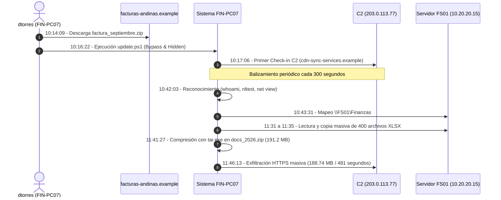

# Línea de Tiempo Cronológica Correlacionada del Incidente

## 1. Diagrama de Secuencia del Ataque (Flujo Global)

---

## 2. Cronología Detallada Segundo a Segundo

| Timestamp | Componente / Fuente | Host / Origen | Destino / Detalle | Tipo de Evento | Impacto / Significado |
|---|---|---|---|---|---|
| **08:30:00** | `endpoint.csv` | IT-PC02 (`jparedes`) | Local | `PROCESS_CREATE` | **Actividad Normal:** Tarea programada de TI ejecutando `Get-Service` cada 7 minutos (Falso positivo descartado). |
| **10:12:41** | `proxy.csv` | FIN-PC07 (`dtorres`) | `facturas-andinas.example` | HTTP GET 200 | Usuario navega a portal web simulado de facturación (`/documentos/94831`). |
| **10:14:09** | `proxy.csv` | FIN-PC07 (`dtorres`) | `facturas-andinas.example` | HTTP GET 200 | **Acceso Inicial:** Descarga de señuelo malicioso `/download/factura_septiembre.zip`. |
| **10:16:22** | `endpoint.csv` | FIN-PC07 (`dtorres`) | Local | `PROCESS_CREATE` | **Ejecución Maliciosa:** Inicio de `powershell.exe -NoProfile -WindowStyle Hidden -ExecutionPolicy Bypass -File C:\Users\dtorres\AppData\Local\Temp\update.ps1`. Padre: `explorer.exe`. |
| **10:17:04** | `dns.csv` | FIN-PC07 (`10.20.10.47`) | DC01 (`10.20.20.10`) | DNS Query 'A' | Resolución de `cdn-sync-services.example` -> Retorna `203.0.113.77`. |
| **10:17:06** | `firewall.csv` | FIN-PC07 (`10.20.10.47`) | `203.0.113.77:443` | TCP OUTBOUND | **Comando y Control (C2):** Primer balizamiento. Envía 1,492 bytes, recibe 3,868 bytes (3s). |
| **10:22:08** | `dns.csv` | FIN-PC07 | DC01 | DNS Query 'A' | Baliza C2 recurrente a `cdn-sync-services.example` (+300 segs). |
| **10:22:10** | `firewall.csv` | FIN-PC07 | `203.0.113.77:443` | TCP OUTBOUND | Conexión C2: Envía 1,499 bytes, recibe 3,991 bytes. |
| **10:27:05** | `dns.csv` | FIN-PC07 | DC01 | DNS Query 'A' | Baliza C2 recurrente (+300 segs). |
| **10:27:07** | `firewall.csv` | FIN-PC07 | `203.0.113.77:443` | TCP OUTBOUND | Conexión C2: Envía 1,473 bytes, recibe 3,651 bytes. |
| **10:32:11** | `dns.csv` | FIN-PC07 | DC01 | DNS Query 'A' | Baliza C2 recurrente (+300 segs). |
| **10:32:13** | `firewall.csv` | FIN-PC07 | `203.0.113.77:443` | TCP OUTBOUND | Conexión C2: Envía 1,351 bytes, recibe 3,366 bytes. |
| **10:37:09** | `dns.csv` | FIN-PC07 | DC01 | DNS Query 'A' | Baliza C2 recurrente (+300 segs). |
| **10:37:11** | `firewall.csv` | FIN-PC07 | `203.0.113.77:443` | TCP OUTBOUND | Conexión C2: Envía 1,184 bytes, recibe 4,056 bytes. |
| **10:42:03** | `endpoint.csv` | FIN-PC07 (`dtorres`) | Local | `PROCESS_CREATE` | **Reconocimiento:** Ejecución de `whoami.exe`. |
| **10:42:19** | `endpoint.csv` | FIN-PC07 (`dtorres`) | Local | `PROCESS_CREATE` | **Reconocimiento AD:** Ejecución de `nltest.exe /dclist:andes.local`. |
| **10:42:51** | `endpoint.csv` | FIN-PC07 (`dtorres`) | Local | `PROCESS_CREATE` | **Reconocimiento de Red:** Ejecución de `net.exe net view`. |
| **10:43:31** | `endpoint.csv` | FIN-PC07 (`dtorres`) | `\\FS01\Finanzas` | `PROCESS_CREATE` | **Conexión a Recursos:** Ejecución de `net.exe net use \\FS01\Finanzas`. |
| **11:20:00** | `firewall.csv` | FS01 (`10.20.20.15`) | `198.51.100.44:443` | TCP OUTBOUND | **Actividad Legítima:** Respaldo automático de 500 MB (524,288,000 bytes) a `backup.example.net` (Falso positivo descartado). |
| **11:31:22** | `endpoint.csv` | FIN-PC07 (`dtorres`) | `\\FS01\Finanzas\...` | `FILE_ACCESS` (READ) | **Inicio de Recolección:** Comienza acceso en ráfaga a archivos contables (Proveedores, Nómina, Presupuestos, Reportes). |
| **11:35:01** | `endpoint.csv` | FIN-PC07 (`dtorres`) | `\\FS01\Finanzas\...` | `FILE_ACCESS` (READ) | **Fin de Recolección:** Finaliza lectura de 400 archivos `.xlsx` y almacenamiento en staging local. |
| **11:41:27** | `endpoint.csv` | FIN-PC07 (`dtorres`) | Local | `PROCESS_CREATE` | **Compresión:** Ejecución de `tar.exe -a -c -f C:\Users\dtorres\AppData\Local\Temp\docs_2026.zip C:\Users\dtorres\AppData\Local\Temp\staging\*`. |
| **11:44:51** | `endpoint.csv` | FIN-PC07 (`dtorres`) | Local | `FILE_CREATE` | Generación de archivo comprimido de 191,284,391 bytes (~191.28 MB). |
| **11:46:13** | `firewall.csv` | FIN-PC07 (`10.20.10.47`) | `203.0.113.77:443` | TCP OUTBOUND | **Exfiltración de Datos:** Envío de 188,743,680 bytes (~188.74 MB) durante 481 segundos hacia servidor C2. |
| **11:54:14** | `firewall.csv` | FIN-PC07 (`10.20.10.47`) | `203.0.113.77:443` | TCP CLOSE | Finaliza la transmisión de datos exfiltrados. |
| **11:55:00 - 14:00:00** | `endpoint.csv` / `proxy.csv` | FIN-PC07 | Varios | Rutina | La víctima continúa operando Office y Chrome sin percatarse de la fuga. |
